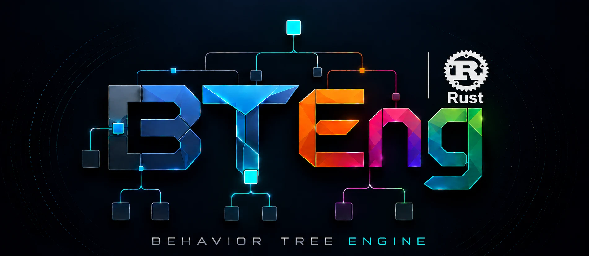

<p align="center">
  
</p>

# BTEng Rust

[](https://www.rust-lang.org/)
[](LICENSE)
[](Cargo.toml)

**A behavior tree engine for robotics and tick-driven control, written in Rust.**

A clean-room sibling of [BTEng](https://pypi.org/project/bteng/) (Python): it takes its lessons
from BTEng and BehaviorTree.CPP, but none of their code. It is built for what the Python engine
cannot do:

- **Multi-rate ticking** — subtrees on their own clocks, scheduled to absolute deadlines.
- **Event-driven ticking** — wake on a blackboard write or a finished async task, not only on a timer.
- **Async leaves that never block the tick** — halting one is non-blocking too.
- **Live reconfiguration** — swap a subtree while its siblings keep running.
- **Zero allocations per tick**, enforced by tests.

About 33–45× faster than Python BTEng on identical trees ([numbers](docs/performance.md)).

---

## Quick start

```bash
cargo test --workspace
cargo run -p bteng-cli -- validate examples/mission.xml
cargo run -p bteng-cli -- run examples/mission.xml --virtual --trace run.jsonl
```

```rust
use bteng_core::{Blackboard, Builtin, Ctx, SimClock, Status, Tree, TreeBuilder};

let mut bb = Blackboard::new();
let graph = TreeBuilder::new()
    .begin("root", Builtin::sequence())
        .leaf("battery_ok", Builtin::condition(|_| true))
        .leaf("navigate", Builtin::action(|_| Status::Success))
    .end()
    .build(&mut bb)?;

let mut tree = Tree::new(graph);
let clock = SimClock::new();
let mut ctx = Ctx::new(&mut bb, &clock);
assert_eq!(tree.tick(&mut ctx), Status::Success);
# Ok::<(), bteng_core::BuildError>(())
```

Trees can also be loaded from BehaviorTree.CPP-style XML. Port values are checked when the
document loads, not when the tree runs.

---

## Documentation

Everything else lives in [`docs/`](docs/README.md):

| Topic | Page |
|-------|------|
| Install, run, first tree in Rust and XML | [Getting started](docs/getting-started.md) |
| Regions, deadlines, event-driven wake-ups | [Multi-rate ticking](docs/multi-rate.md) |
| Swap subtrees while running | [Live reconfiguration](docs/live-reconfiguration.md) |
| Benchmarks and targets | [Performance](docs/performance.md) |
| What each crate does | [Crates](docs/crates.md) |
| What is and is not established | [Status](docs/status.md) |

---

## Status

**`v1.0.0`** — all seven planned milestones are in. Known limits: there is
**no ARM hardware run**, **no `loom` tests**, and **nothing has driven a physical machine** yet.
Every timing figure is x86-only. Details in [Status](docs/status.md).

## License

MIT.
